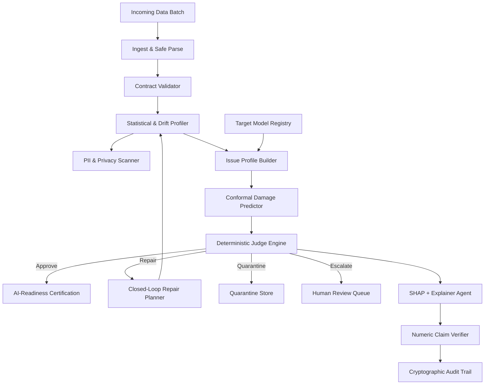

# TrustGate: Impact-Aware Data Trust & Verification Agent

> **TrustGate** is an enterprise data trust and verification agent that protects downstream ML models and analytical pipelines by predicting the downstream degradation caused by data corruption, rather than counting arbitrary rule violations.

---

## 1. Overview

Traditional data quality tools (Great Expectations, Deequ, Soda) operate on declarative rule counts or isolated p-values. If an un-modeled auxiliary column is missing, pipelines crash; if a critical feature subtly drifts, models fail silently.

**TrustGate** bridges data governance, statistical profiling, and machine learning:
1. **Profiles** incoming batches for quality, statistical drift (KS, PSI, $\chi^2$, JS), PII leaks, and schema contract breaches.
2. **Predicts** exact downstream model degradation ($Damage$) using a calibrated, monotonic gradient-boosted regressor equipped with split-conformal prediction intervals.
3. **Decides** deterministically among `APPROVE`, `REPAIR_THEN_APPROVE`, `QUARANTINE`, and `ESCALATE_TO_HUMAN`.
4. **Verifies Repairs** in a closed loop: repaired data is re-profiled and re-predicted before approval.
5. **Explains** decisions with SHAP feature attributions and an LLM narrative strictly verified by a deterministic numeric-claim verifier.
6. **Certifies** data batches with an AI-Readiness score (0–100) and cryptographically seals the provenance in an append-only, hash-chained audit log.

---

## 2. Quickstart

```bash
# Setup virtual environment
uv venv --python 3.11 .venv
source .venv/bin/activate  # or .venv\Scripts\activate on Windows

# Install dependencies
uv pip install -e ".[dev]"

# Run tests
pytest

# Start the API
uvicorn trustgate.api.app:app --host 0.0.0.0 --port 8000

# Start the Streamlit UI
streamlit run src/trustgate/ui/dashboard.py
```

---

## 3. Architecture


