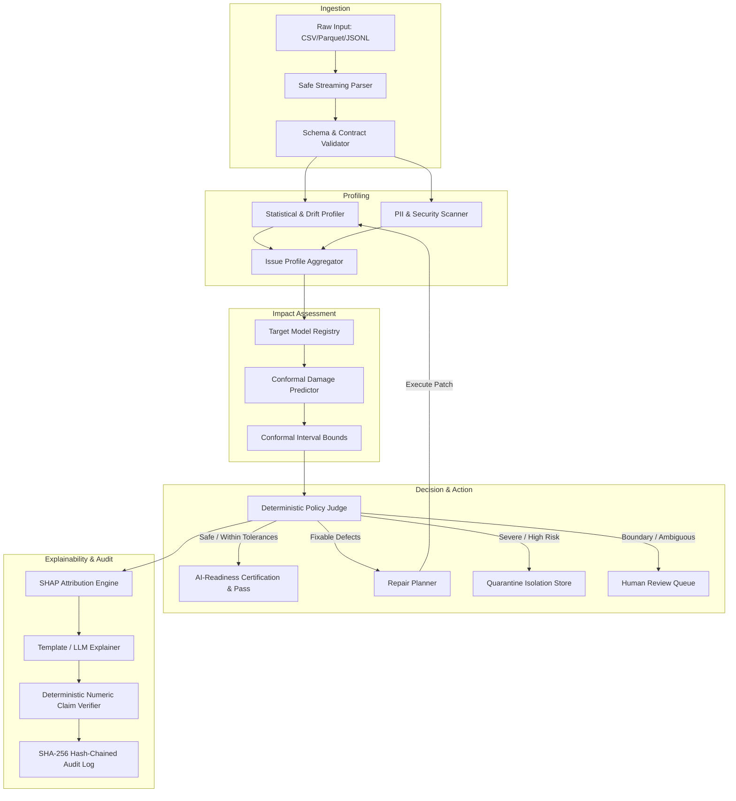

# TrustGate Architecture Specification

## 1. System Philosophy and Objectives

TrustGate is an impact-aware data validation and risk mitigation agent that sits between upstream data producers and downstream consumers (machine learning models, analytical dashboards, reporting pipelines).

### Core Pillars
1. **Model-Aware Impact Prediction**: Data defects are evaluated in terms of their projected degradation on downstream model metrics ($\Delta Metric$), not raw violation counts.
2. **Deterministic Governance**: Gating decisions (`APPROVE`, `REPAIR_THEN_APPROVE`, `QUARANTINE`, `ESCALATE_TO_HUMAN`) are governed by deterministic policies and conformal confidence bounds, never non-deterministic generative models.
3. **Closed-Loop Verification**: Automated data repairs are subjected to secondary profiling and re-prediction to ensure that cleaning steps do not introduce secondary distortions.
4. **Verifiable Auditability**: Every batch execution creates a cryptographically hash-chained record linking raw input hashes, issue profiles, conformal intervals, policy outcomes, and repair patches.

---

## 2. Component Pipeline

---

## 3. Detailed Subsystem Specifications

### 3.1 Ingestion & Contract Validation (`trustgate.ingest`, `trustgate.contracts`)
- **Safe Readers**: Streaming and chunked readers backed by `polars` and `pyarrow`. Hard limits on decompression ratios (defending against decompression bombs) and strict typing.
- **Contract Engine**: Validates column existence, nullability constraints, range boundaries, allowable enums, and regex patterns with strict timeout guards.

### 3.2 Profiling & PII Scanning (`trustgate.profiling`, `trustgate.pii`)
- **Two Operating Modes**:
  - *Labeled Batch Mode*: Evaluates target distribution, class balance, label noise, and concept drift.
  - *Unlabeled Batch Mode*: Focuses on feature drift, missingness patterns (MCAR, MAR, MNAR indicators), outliers, and schema compliance.
- **Statistical Tests**: Two-sample Kolmogorov-Smirnov (numeric), Population Stability Index (PSI with $\epsilon$-smoothing), Chi-Square test (categorical), and Cramér's V effect sizes.
- **PII Detectors**: Checksum-verified detectors (Verhoeff for 12-digit Indian Aadhaar, Luhn for Credit Cards, PAN regex, email, international phone numbers, UPI IDs, IPv4/v6) and reversible HMAC tokenization with environment-secured salting.

### 3.3 Damage Prediction (`trustgate.damage`)
- **Feature Builder**: Extracts importance-weighted missingness rates, maximum/mean feature group PSI, outlier proportions, type anomaly frequencies, and schema deviation flags.
- **Predictor Model**: Calibrated Gradient Boosted Trees with monotonic constraints (e.g., increased missingness in a key feature must monotonically increase or maintain predicted damage).
- **Split-Conformal Inference**: Computes finite-sample calibrated prediction intervals $[Damage_{lower}, Damage_{upper}]$. The Judge leverages $Damage_{upper}$ for conservative, risk-averse gating.
- **Out-of-Distribution (OOD) Guard**: Employs an Isolation Forest / Mahalanobis distance metric on the issue profile. If the issue profile deviates from the training distribution, it flags `LOW_CONFIDENCE` and escalates.

### 3.4 Deterministic Judge & Policy Engine (`trustgate.policy`)
- Purely deterministic Python evaluation of `configs/policy.yaml`.
- Enforces strict precedence:
  1. **Hard Block Rules**: Unmasked direct PII or critical schema breaking changes $\to$ Immediate `QUARANTINE`.
  2. **High Impact**: $Damage_{upper} > \tau_{reject}$ $\to$ `QUARANTINE`.
  3. **Repairable**: $Damage_{upper} > \tau_{approve}$ but eligible for repair actions with estimated post-repair damage below $\tau_{approve}$ $\to$ `REPAIR_THEN_APPROVE`.
  4. **Low Confidence**: OOD flag triggered or boundary condition $\to$ `ESCALATE_TO_HUMAN`.
  5. **Clean**: All signals within tolerance $\to$ `APPROVE`.

### 3.5 Closed-Loop Repair Library (`trustgate.repair`)
- Atomic, reversible repair strategies: Reference-fitted median/mode imputation, winsorization, type coercion, sentinel-to-null replacement, and schema column realignment.
- Generates a lineage patch documenting every transformed cell.
- Re-profiles and re-predicts post-repair data. If the repaired batch introduces new defects or post-repair predicted damage remains elevated, the batch is rolled back and quarantined.

### 3.6 Explainability & Verification (`trustgate.agents`, `trustgate.audit`)
- Generates SHAP attributions identifying which feature defects drove the damage prediction.
- Explainer formats role-specific reports (Data Engineer, Data Scientist, Risk Officer).
- **Numeric-Claim Verifier**: Parses every numerical assertion in the generated explanation and cross-checks against the decision record. Discrepancies trigger instant fallback to the deterministic template explainer.
- **Audit Logger**: Appends structured JSON records chained by cryptographic SHA-256 hashes (`current_hash = SHA256(prev_hash + record_payload)`).
